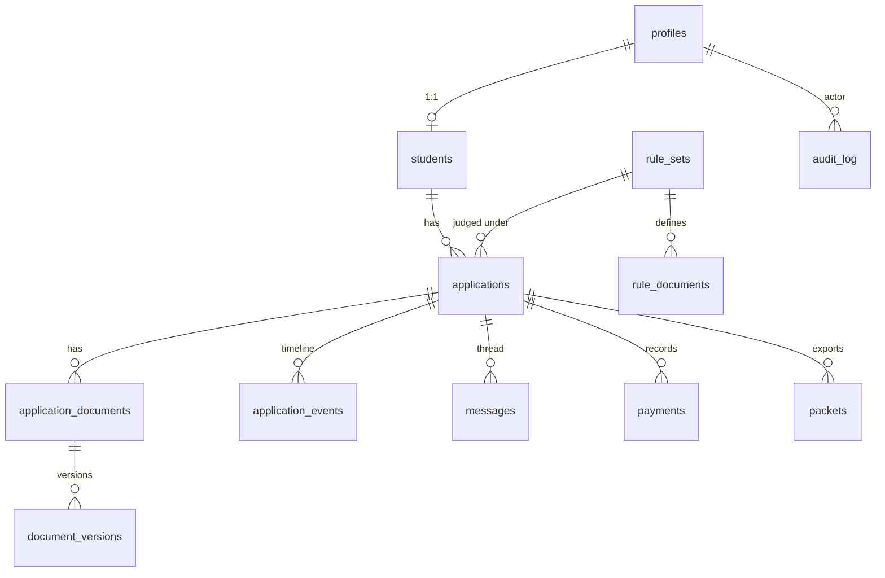

# VisaDesk — Architecture

Companion to `concept.md`, `prd.md`, `design.md`. This file defines *how* to build it.

## 1. Principles

1. **Policy is data.** Requirements, fees, deadlines, and exemptions live in versioned DB rows.
2. **Security at the database.** Row-level security (RLS) is the real gate; the app layer is convenience.
3. **Validate twice.** Client for speed and coaching, server for truth.
4. **Boring, reliable tech.** Managed services, few moving parts, one language (TypeScript).
5. **Idempotent everything** for jobs, emails and uploads.

## 2. Stack

| Layer | Choice | Notes |
|---|---|---|
| Frontend | **Next.js (App Router) + TypeScript**, React Server Components where possible | PWA via `serwist` or a hand-written service worker |
| UI | Tailwind CSS + shadcn/ui (Radix) + Framer Motion (sparingly) | Tokens from `design.md` |
| Forms/validation | React Hook Form + **Zod** (schemas shared client/server) | Single source in `packages/shared` |
| Data/Auth/Storage | **Supabase**: Postgres, Auth (email OTP), private Storage, RLS, `pg_cron`, Edge Functions | Region: closest available to East Africa (e.g. eu-west or af-south if offered) |
| Image processing (client) | Canvas API, `heic2any` (lazy loaded), `pdfjs-dist` (lazy loaded), small Laplacian blur routine in a Web Worker | Keep student route JS small |
| Image processing (server) | `sharp` in a Node route/Edge-compatible worker for re-encode, EXIF strip, hash | Runs on upload-confirm |
| PDF generation | `pdf-lib` (cover sheet) | |
| ZIP | `fflate` streaming | Packets are small (≤ ~25 MB) |
| Email | **Resend** (React Email templates) | Provider behind `NotificationChannel` interface |
| Hosting | **Vercel** (app), Supabase (data) | Staging + production environments |
| Observability | Sentry, Vercel Analytics (no PII), Supabase logs | |
| Testing | Vitest, Playwright, pgTAP (RLS tests) | |
| Tooling | pnpm workspaces, ESLint, Prettier, Husky, GitHub Actions | |

## 3. Repository layout

```
visadesk/
├─ apps/web/                  # Next.js app
│  ├─ app/
│  │  ├─ (auth)/login, verify
│  │  ├─ (student)/apply, checklist, documents/[type], review, status, messages
│  │  ├─ (staff)/dashboard, applications/[id], review-mode, packets, reminders
│  │  ├─ (admin)/rules, staff, templates, retention, audit, analytics
│  │  └─ api/ (upload-confirm, packets, health, cron/*)
│  ├─ components/ (ui, runway, scan-coach, doc-viewer, checklist)
│  ├─ lib/ (supabase clients, auth guards, i18n)
│  └─ workers/ (blur-check.worker.ts)
├─ packages/shared/           # zod schemas, risk-band logic, rule engine, types
├─ supabase/
│  ├─ migrations/             # SQL, ordered, reproducible
│  ├─ seed.sql                # rule set v1, reason templates
│  ├─ functions/              # edge functions (daily-runway, retention-sweep, send-email)
│  └─ tests/                  # pgTAP RLS tests
├─ docs/ (DECISIONS.md, SECURITY.md, RUNBOOK.md)
└─ .github/workflows/
```

## 4. Domain model



### 4.1 Tables (key columns)

- **profiles**: `id (uuid = auth.users.id)`, `email`, `full_name`, `role` (`student|dos_staff|dos_admin|liaison`), `created_at`. Role changes only via service role.
- **students**: `profile_id`, `student_no (unique)`, `nationality (ISO 3166 alpha-2)`, `student_type`, `programme`, `phone`.
- **rule_sets**: `id`, `version (int)`, `status (draft|published|retired)`, `fee_usd`, `penalty_usd_per_day`, `apply_before_days`, `max_pass_months`, `exempt_countries text[]`, `reminder_days int[]`, `published_at`, `published_by`, `notice_date`.
- **rule_documents**: `rule_set_id`, `code`, `name`, `help_text`, `where_to_get`, `example_path`, `applies_to_types text[]`, `min_files`, `source (notice|student_addition)`, `sort`.
- **applications**: `id`, `ref (VD-YYYY-NNNNN)`, `student_id`, `rule_set_id`, `status`, `current_expiry date null`, `requested_months`, `fee_status`, `submitted_at`, `claimed_by`, `claimed_until`, `closed_at`, `new_expiry date null`.
- **application_documents**: `id`, `application_id`, `doc_code`, `state (missing|uploaded|approved|rejected)`, `current_version_id`, `reviewer_id`, `reviewer_reason_code`, `reviewer_note`, `reviewed_at`.
- **document_versions**: `id`, `application_document_id`, `seq`, `storage_path`, `sha256`, `width`, `height`, `bytes`, `quality jsonb` (blur, glare, warnings), `uploaded_at`, `deleted_at`.
- **application_events**: `id`, `application_id`, `type`, `data jsonb`, `actor_id`, `at` (student-visible timeline).
- **messages**: `id`, `application_id`, `sender_id`, `body`, `internal boolean` (staff notes), `at`.
- **payments**: `id`, `application_id`, `amount_ugx`, `paid_on`, `reference`, `receipt_path null`, `recorded_by`.
- **packets**: `id`, `application_id`, `generated_by`, `storage_path`, `manifest jsonb`, `sent_at`, `sent_method (email|in_person)`.
- **reason_templates**: `code`, `label`, `body`, `active`.
- **notifications**: `id`, `application_id`, `kind`, `channel`, `dedupe_key (unique)`, `status`, `sent_at`, `error`.
- **audit_log**: `id bigserial`, `at`, `actor_id`, `action`, `target_type`, `target_id`, `meta jsonb`, `prev_hash`, `hash`. Hash = SHA-256(prev_hash ‖ canonical row). INSERT-only (no UPDATE/DELETE grants; trigger blocks both).
- **settings**: key/value for retention days, domain allow-list, feature flags.

Indexes: `applications(status, current_expiry)`, `applications(student_id)`, `application_documents(application_id, state)`, `notifications(dedupe_key)`.

Views: `v_runway` computing `days_to_expiry`, `apply_by`, `risk_band`, `penalty_estimate_usd` per student's latest application (single place for the logic; mirrored by `packages/shared` for unit tests).

## 5. Rule engine

Pure function in `packages/shared`:

```ts
computeChecklist(ruleSet, { studentType, nationality }) -> {
  items: ChecklistItem[],      // filtered by applies_to_types, with min_files
  feeRequired: boolean,        // false if nationality in exempt_countries
  applyBy(expiry): Date,       // expiry - apply_before_days
  riskBand(expiry, today): 'safe'|'plan'|'urgent'|'critical'|'expired'|'no_pass',
  penaltyEstimate(expiry, today): number
}
```

Always compute "today" in `Africa/Kampala`. Heavily unit-tested (boundary days 0, 7, 8, 30, 31, 60, 61, leap years).

## 6. Security architecture

- **Auth**: Supabase Auth, email OTP. A `before-user-created` hook (or DB trigger + auth hook) rejects emails outside the allow-listed domain(s) for student sign-up. Staff are created by admin invite and bypass the domain rule only if the admin explicitly allows.
- **RLS** (every table enabled; default deny):
  - Student: `SELECT/INSERT/UPDATE` only rows where the application belongs to `auth.uid()`; cannot update `status`, `fee_status`, reviewer fields (enforced by column-level privileges and `SECURITY DEFINER` RPCs for transitions).
  - Staff/admin: read all; mutate through RPCs that check role via `profiles.role` (never from JWT claims the user can influence).
  - `messages.internal = true` invisible to students.
- **State transitions** only via RPCs (`submit_application`, `review_document`, `mark_approved`, `generate_packet`, …) that validate current state, write events and audit rows atomically.
- **Storage**: bucket `documents` private. Path: `{application_id}/{doc_code}/{seq}.jpg`. Storage policies mirror RLS. Downloads via signed URLs ≤ 60 s generated server-side after an authorization check; staff views of sensitive files write an audit row.
- **Upload flow** (see §7) uses a short-lived signed upload URL scoped to one path.
- **Headers**: strict CSP, `Referrer-Policy: no-referrer`, `X-Content-Type-Options`, frame-ancestors none.
- **Rate limits**: OTP requests per email/IP, upload-confirm per user (Upstash or Postgres-based limiter).
- **Secrets**: only in Vercel/Supabase env; service role key never reaches the browser.
- **Retention**: daily `retention-sweep` deletes storage objects and nulls personal columns for applications past retention; writes redacted audit entries.
- **Backups**: Supabase PITR; quarterly restore drill documented in `RUNBOOK.md`.

## 7. Key flows

### 7.1 Document upload
1. Student picks or captures a file → client detects type.
2. Convert to JPG (HEIC/PNG/WebP/PDF page → canvas → JPEG), downscale if > 12 MP.
3. Web Worker runs quality checks → results shown; hard fail blocks.
4. Client requests `POST /api/uploads/sign` with `{application_id, doc_code}` → server verifies ownership and state, returns a signed upload URL (resumable/TUS for large files).
5. Client uploads; then `POST /api/upload-confirm`.
6. Server downloads the object, verifies magic bytes, dimensions, size, strips EXIF, re-encodes if needed, computes SHA-256, inserts `document_versions`, updates `application_documents.state='uploaded'`, writes event and audit.
7. UI updates optimistically and reconciles via Supabase Realtime or refetch.

### 7.2 Review
Staff opens Review Mode → `claim_application` RPC → viewer loads signed URL → `review_document(doc_id, decision, reason_code, note)` RPC → if all decided, state transitions and a single batched notification is queued → `notifications` row with `dedupe_key` → email sent by edge function with retry.

### 7.3 Daily Runway job (`pg_cron` → edge function `daily-runway`, 06:00 Africa/Kampala)
For each student with a latest application or known expiry: compute band; for each configured reminder day crossed and not yet sent (dedupe by `{student}:{expiry}:{day}`), enqueue email; update flags used by the dashboard.

### 7.4 Packet generation
RPC verifies `approved`; route handler fetches each current JPG via service role, builds ZIP with `fflate`, renders `cover_sheet.pdf` with `pdf-lib`, writes `manifest.json`, stores in a private `packets` bucket, inserts `packets` row, returns a signed URL; audit logged.

## 8. API surface (route handlers / RPCs)

| Endpoint | Purpose | Auth |
|---|---|---|
| `POST /api/uploads/sign` | Signed upload URL | student |
| `POST /api/upload-confirm` | Validate and register a version | student |
| `GET /api/files/[versionId]` | Short-lived signed URL redirect | owner or staff (audited) |
| `POST /api/packets/[applicationId]` | Build packet | staff |
| `GET /api/health` | Liveness | public |
| `POST /api/cron/*` | Triggered by Supabase cron with secret | internal |
| RPC `submit_application`, `review_document`, `mark_approved`, `record_payment`, `mark_sent_to_immigration`, `record_pass_issued`, `claim_application`, `publish_rule_set` | State changes | per role |

## 9. Performance

- Server components and server-side pagination for dashboard; cursor-based.
- Student route loads only essentials; `heic2any` and `pdfjs` loaded on demand.
- Thumbnails (400 px) generated server-side at upload-confirm and stored beside the original for fast grids.
- Image CDN not used for sensitive files; thumbnails also private with signed URLs.

## 10. Environments, CI/CD

- `main` → staging auto-deploy; tagged release → production.
- CI: typecheck, lint, unit tests, pgTAP RLS tests against a local Supabase, Playwright e2e on preview.
- Migrations only forward; seed script idempotent.
- Env vars (document in `.env.example`): `NEXT_PUBLIC_SUPABASE_URL`, `NEXT_PUBLIC_SUPABASE_ANON_KEY`, `SUPABASE_SERVICE_ROLE_KEY`, `RESEND_API_KEY`, `CRON_SECRET`, `SENTRY_DSN`, `APP_NAME`, `ALLOWED_EMAIL_DOMAINS`, `DEFAULT_TIMEZONE=Africa/Kampala`.

## 11. Risks and mitigations

| Risk | Mitigation |
|---|---|
| Requirements change | Rule sets versioned and admin-editable |
| Students on poor connections | Resumable uploads, compression, PWA, draft autosave |
| Misleading blur/glare checks | Soft warnings with "use anyway"; thresholds in settings; log results to tune |
| Email deliverability to university domain | SPF/DKIM/DMARC on sending domain; in-app inbox as fallback |
| Staff over-access to sensitive IDs | Role limits, audited file views, retention sweep |
| Vendor lock-in | Thin data-access layer; plain SQL migrations; `NotificationChannel` interface |
| Timezone/date bugs around expiry | Single `Africa/Kampala` date utility, boundary tests |

## 12. Extension points

SMS/WhatsApp channel, SSO, on-device OCR verification, liaison role with packet inbox, Swahili/French locales, calendar (.ics) export of apply-by dates.
